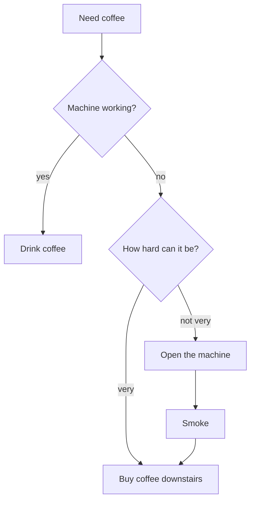
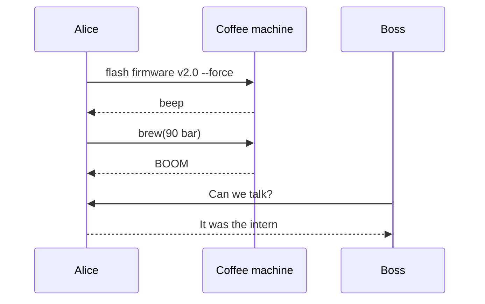
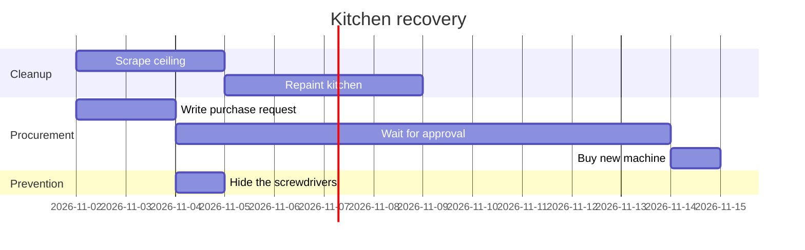
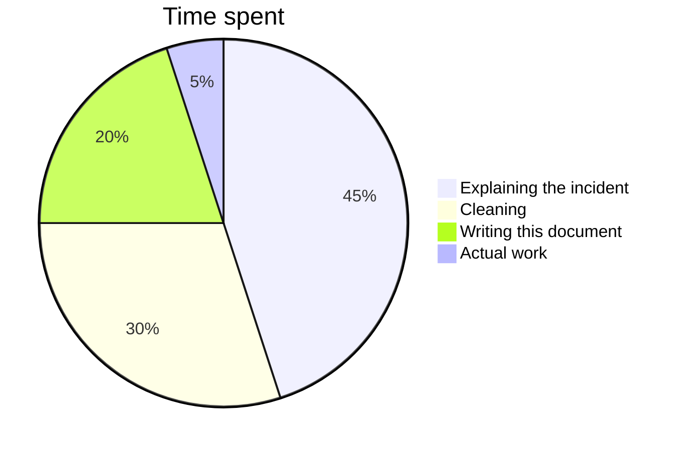
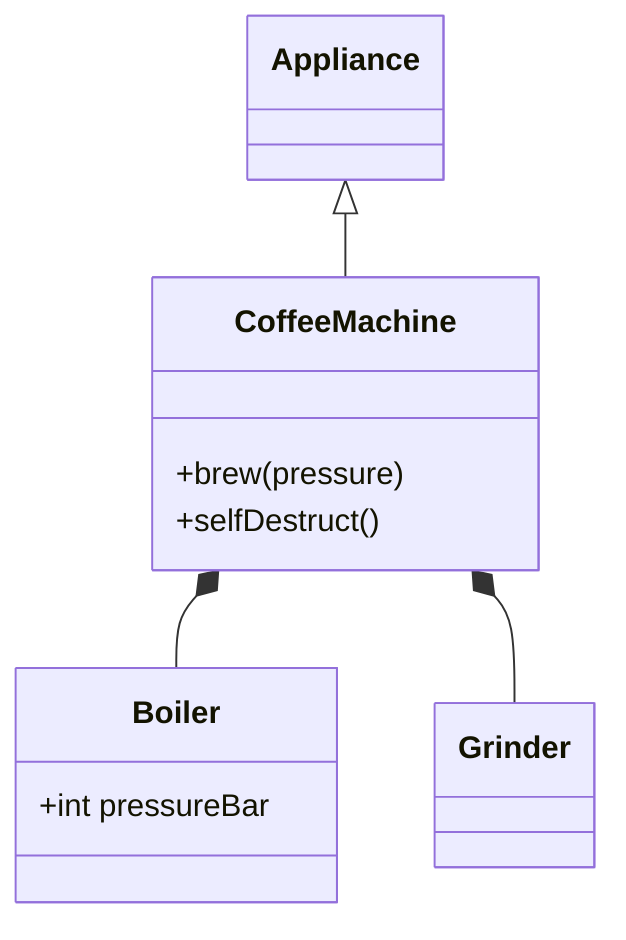
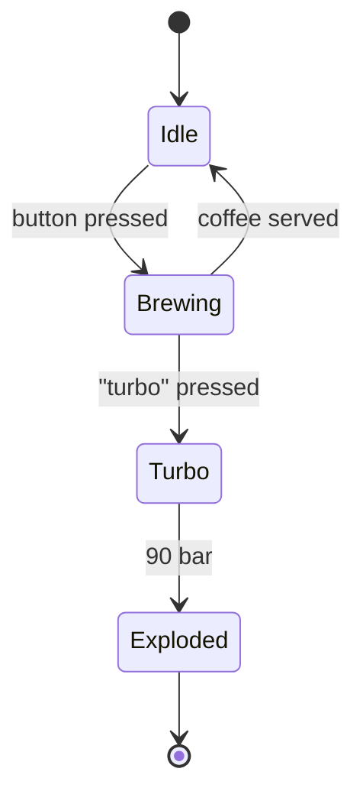

# The Great Coffee Machine Incident

*An engineering post-mortem, and a tour of everything md_viewer can show.*
Open it with `md_viewer showcase.md` (or `cargo run -- showcase.md`).

> **Severity:** critical. **Blast radius:** the third-floor kitchen.
> **Root cause:** a developer with a whiteboard and too much free time.

---

## 1. Summary

On a quiet Tuesday, the team decided the office coffee machine was
*suboptimal*. Nobody asked them to fix it. They fixed it **anyway**. The
machine is now ~~a coffee machine~~ a modern art installation, and the
kitchen smells of `burnt_ambition.log`.

Further reading: the [incident tracker](https://example.com/incident/42) and
the only surviving photo of the machine .

### 1.1 Timeline of the morning

1. 08:59 - Kettle declared "legacy".
2. 09:03 - Someone says "how hard can it be?"
3. 09:04 - Whiteboard produced.
4. 09:47 - Smoke.

#### 1.1.1 Who was involved

- **Alice** - wrote the firmware
    - in Rust, *naturally*
    - with zero `unsafe` and zero coffee
- **Bob** - "load tested" the boiler
- **Carol** - kept saying "this is a bad idea" and was, for the record, right

##### Action items

- [x] Blame the intern
- [x] Discover we have no intern
- [ ] Buy a new machine
- [ ] Never let Alice near a pressure valve again

###### Footnote-sized heading for footnote-sized hope

A coffee costs $5 in the shop downstairs, which is how this all started.

---

## 2. The firmware

Alice's brewing routine, reconstructed from what was left of the flash chip:

```rust
/// Brews one cup. Probably.
fn brew(pressure_bar: f64) -> Result<Coffee, Explosion> {
    if pressure_bar > 9.0 {
        // "Espresso is 9 bar, so 90 bar is ten times better espresso."
        return Err(Explosion::Spectacular);
    }
    Ok(Coffee::default())
}
```

And the deployment script, which ran with no review:

```sh
#!/bin/sh
set -e   # stop on the first error (there were many)
make firmware && flash --force --yes --i-know-what-im-doing /dev/coffee0
```

> Carol, in the review that never happened:
>
> > "Why is there a `--force` flag on a *kettle*?"
>
> Nobody answered.

---

## 3. The numbers

Daily consumption before and after the incident:

| Developer | Cups before | Cups after | Mood |
|:----------|:-----------:|-----------:|------|
| Alice | 2 | **0** | *in denial* |
| Bob | 7 | 12 | ~~fine~~ vibrating |
| Carol | 1 | 1 | `smug` |
| The intern | n/a | n/a | [does not exist](https://example.com/intern) |

What each of them said in the retrospective:

| Who | Statement |
|---|---|
| Alice | The pressure valve was clearly a suggestion, not a requirement, and I stand by my interpretation of the datasheet even though the datasheet is now on fire. |
| Bob | I would like it noted that I only pressed the button labelled "turbo", and that nobody should have put a button labelled "turbo" on a coffee machine in the first place. |
| Carol | I told you so. I have it in writing. I have it in three different chat channels. |

The science, compressed into a table:

| Quantity | Value | Notes |
|:---------|:-----:|------:|
| Caffeine | $\ce{C8H10N4O2}$ | the good stuff |
| Half-life | $t_{1/2} = \frac{\ln 2}{k} \approx 5\,\mathrm{h}$ | in Bob, about 20 minutes |
| Boiling point | $\pu{100 °C}$ | at sea level, not at 90 bar |
| Bob's heart rate | $\lim_{t \to 09{:}47} h(t) = \infty$ | clinically interesting |

---

## 4. The mathematics of caffeine

The caffeine level $C(t)$ in a developer decays exponentially,
$C(t) = C_0 e^{-kt}$, until the next cup arrives. With a dosing function
$D(t)$ this is the first differential equation of the day:

$$
\frac{dC}{dt} = -k\,C(t) + D(t)
$$

Its solution, for the mathematically caffeinated:

$$
C(t) = C_0 e^{-kt} + \int_0^t e^{-k(t-s)}\,D(s)\,ds
$$

Meanwhile the forgotten cup on Alice's desk obeys Newton's law of cooling,
where $T_a$ is the room temperature:

$$
\frac{dT}{dt} = -r\,(T - T_a) \quad\Rightarrow\quad T(t) = T_a + (T_0 - T_a)\,e^{-rt}
$$

Heat spreading through the kitchen counter after the explosion follows the
heat equation:

$$
\frac{\partial u}{\partial t} = \alpha \left( \frac{\partial^2 u}{\partial x^2} + \frac{\partial^2 u}{\partial y^2} \right)
$$

Bob, after twelve cups, is best modelled as a damped harmonic oscillator
driven at the frequency of his own keyboard:

$$
m\ddot{x} + c\dot{x} + kx = F_0 \cos(\omega t)
$$

And the eternal struggle between coffee $c$ and productivity $p$ is a
Lotka-Volterra predator-prey system:

$$
\begin{cases}
\dfrac{dc}{dt} = \alpha c - \beta c p \\[1ex]
\dfrac{dp}{dt} = \delta c p - \gamma p
\end{cases}
$$

The office coffee budget, as a matrix equation nobody approved:

$$
\begin{pmatrix} \text{Alice} & \text{Bob} \\ \text{Carol} & \text{Intern} \end{pmatrix}
\begin{pmatrix} \text{cups} \\ \text{price} \end{pmatrix}
= \sum_{d=1}^{365} \text{regret}_d
$$

Finally, the total enthusiasm of the team, which converges (unlike the
machine): $\sum_{n=1}^{\infty} \frac{1}{n^2} = \frac{\pi^2}{6}$, and the
mandatory reminder that $e^{i\pi} + 1 = 0$ even during an incident.

---

## 5. The chemistry

Coffee, in one molecule: $\ce{C8H10N4O2}$. Bob, in one molecule: also
$\ce{C8H10N4O2}$, mostly.

What should happen inside the boiler:

$$\ce{H2O(l) ->[\Delta] H2O(g)}$$

What happened inside the boiler once the descaler met the heating element:

$$\ce{CaCO3(s) + 2H+ -> Ca^2+ + CO2 ^ + H2O}$$

The milk frother's contribution, an equilibrium nobody wanted:

$$\ce{CO2 + H2O <=> H2CO3 <=> H+ + HCO3-}$$

And the energy released, according to Alice's spreadsheet:
$\pu{-890 kJ/mol}$ per mole of methane in the kitchen gas line, which was
"definitely not involved".

---

## 6. Diagrams

The decision process that led to the incident:



The conversation, as recovered from the chat logs:



The recovery plan, which is already late:



Where the team's time went that week:



The machine's software architecture, as Alice drew it on the whiteboard:



And the states the machine actually went through:



---

## 7. Lessons learned

1. A coffee machine is not a pressure-testing rig.
2. A button labelled "turbo" is a dare, not a feature.
3. Carol is always right.

Raw HTML is shown as text here, like the kitchen's new sign:
<b>No firmware updates in the kitchen.</b>

*Fin. The kettle is back in production.*
