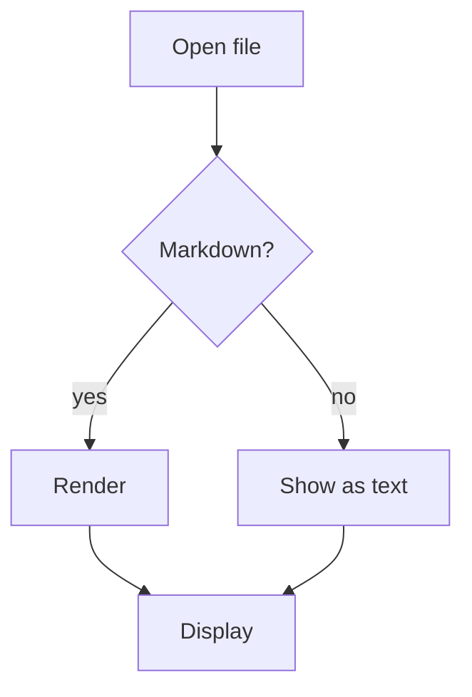
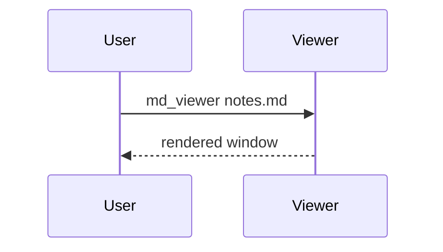
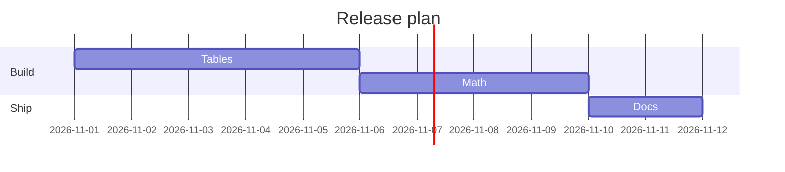
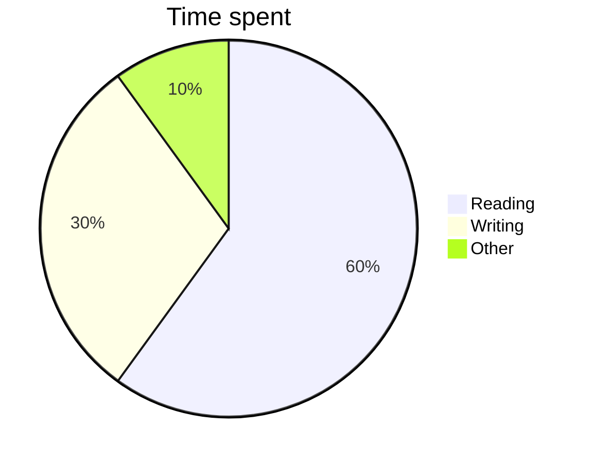

# md_viewer showcase

Every feature the viewer renders, in one document. Open it with
`md_viewer tests/fixtures/showcase.md`.

## Text

Plain text with **strong**, *emphasis*, ~~strikethrough~~, `inline code`,
a [link](https://example.com) and an image placeholder .

> A block quote,
> spanning two lines.

- An unordered list
    - nested
- [x] a finished task
- [ ] an open task

1. An ordered list
2. second item

```rust
fn main() {
    println!("a code block");
}
```

---

## Tables

| Left | Center | Right | Styled |
|:-----|:------:|------:|--------|
| a | b | 1600 | **bold** and `code` |
| longer text | c | 12 | [link](https://example.com) |
| d | e | 3 | ~~gone~~ |

| Topic | Description |
|---|---|
| Wrapping | A long cell wraps onto several lines instead of stretching the table beyond the width of the window. |
| Math | $E = mc^2$ and $\ce{H2O}$ inside cells |

## Math

Inline math such as $x = \frac{-b \pm \sqrt{b^2 - 4ac}}{2a}$ and
$e^{i\pi} + 1 = 0$ flows with the text; a price like $5 does not.

$$
f(x) = \int_{-\infty}^\infty \hat f(\xi)\,e^{2 \pi i \xi x} \,d\xi
$$

$$
\begin{pmatrix} a & b \\ c & d \end{pmatrix}
\begin{pmatrix} x \\ y \end{pmatrix}
= \sum_{k=1}^{n} \lambda_k v_k
$$

## Chemistry (mhchem)

Combustion: $\ce{CH4 + 2O2 -> CO2 + 2H2O}$.

$$\ce{Hg^2+ ->[I-] HgI2 ->[I-] [Hg^{II}I4]^2-}$$

$$\ce{CO2 + C <=> 2CO} \qquad \pu{123 kJ/mol}$$

## Diagrams (Mermaid)









## Fallbacks

A diagram that cannot be parsed is shown as its source with the reason:

```mermaid
graph TD; A-->
```

Raw HTML is shown as text: <b>not bold</b>.
